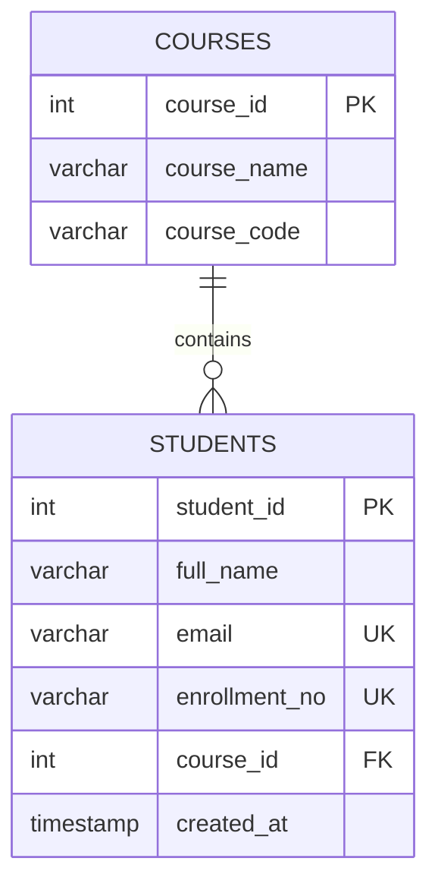

# StudentHub ER Model

## Entities
- **Course** (`course_id` PK, `course_name`, `course_code`)
- **Student** (`student_id` PK, `full_name`, `email` UNIQUE, `enrollment_no` UNIQUE, `course_id` FK, `created_at`)

## Relationship
One Course can have many Students; each Student belongs to one Course (1:N).

